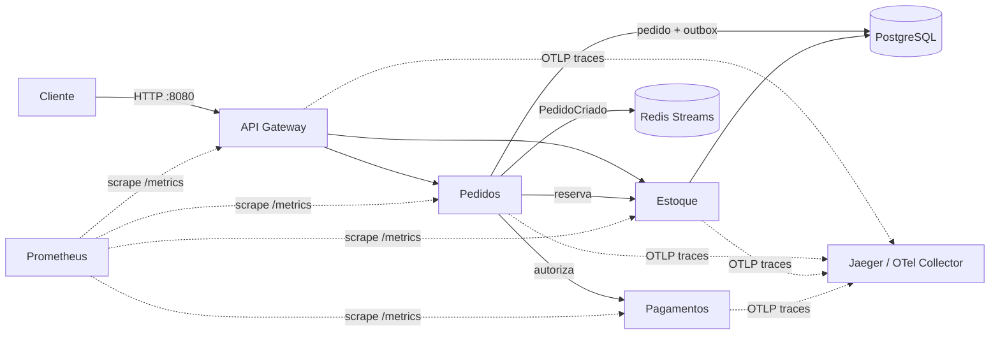

# Loja Veloz | Plataforma de pedidos em microsserviços

Entrega contínua da aplicação **Pedidos Veloz**: do Docker Compose ao Kubernetes, com CI/CD, observabilidade (métricas, logs e traces) e infraestrutura como código.

## Entregáveis

- [Relatório final da Loja Veloz em PDF](Relatorio_Loja_Veloz_UniFECAF.pdf)
- [Vídeo da apresentação no YouTube](https://youtu.be/XociYp9OuyI)
- [Código do projeto no GitHub](https://github.com/barbaraleao-28/loja-veloz-devops)
- [Registros dos testes](evidencias/). As capturas de tela estão no relatório final.

## Arquitetura



## Onde está cada requisito

| Requisito do trabalho | Onde |
|---|---|
| Ambiente local com um comando, redes, volumes e variáveis | [docker-compose.yml](docker-compose.yml), [.env.example](.env.example) |
| Dockerfiles multi-stage, não-root, dependências mínimas | `services/*/Dockerfile`, `services/*/.dockerignore` |
| Versionamento de imagens (SemVer + SHA do commit, GHCR) | [.github/workflows/ci-cd.yaml](.github/workflows/ci-cd.yaml) (job 3) |
| Deployments, Services, Ingress | [k8s/03-deployments.yaml](k8s/03-deployments.yaml), [k8s/04-services.yaml](k8s/04-services.yaml) |
| ConfigMap e Secret | [k8s/01-configmap.yaml](k8s/01-configmap.yaml), [k8s/02-secret.yaml](k8s/02-secret.yaml) (modelo) |
| Readiness/liveness probes | [k8s/03-deployments.yaml](k8s/03-deployments.yaml) (`/ready` e `/health`) |
| Pod Security Admission, NetworkPolicy, PDB | [k8s/00-namespace.yaml](k8s/00-namespace.yaml), [k8s/06-network-policy.yaml](k8s/06-network-policy.yaml), [k8s/07-pdb.yaml](k8s/07-pdb.yaml) |
| Pipeline: lint, testes, build, scan, publicação, deploy | [.github/workflows/ci-cd.yaml](.github/workflows/ci-cd.yaml) |
| Estratégia de deploy (RollingUpdate + rollback) | `strategy` em [k8s/03-deployments.yaml](k8s/03-deployments.yaml), job 4 do pipeline |
| Escalabilidade (HPA e VPA) | [k8s/05-hpa.yaml](k8s/05-hpa.yaml), [k8s/opcional/vpa-recomendacao.yaml](k8s/opcional/vpa-recomendacao.yaml) |
| Métricas, logs e tracing distribuído | `/metrics` e logs JSON em `services/*/src`, `services/*/src/telemetry.js`, [observability/](observability/) |
| IaC com Terraform | [terraform/](terraform/) |

## 1. Rodar com Docker Compose (recomendado)
Em um host com Docker Engine e o plugin Compose, na raiz do projeto:
```powershell
Copy-Item .env.example .env
docker compose up -d --build
docker compose ps
node scripts/smoke.js
docker compose exec redis redis-cli XRANGE pedidos:eventos - + COUNT 10
docker compose down
```
| Serviço | Endereço |
|---|---|
| Painel e API Gateway | http://127.0.0.1:8080 |
| Jaeger (traces) | http://127.0.0.1:16686 |
| Prometheus | http://127.0.0.1:9090 |
| Grafana (fontes já provisionadas) | http://127.0.0.1:3000 |

Substitua as credenciais de exemplo do `.env`. Mudanças em `db/init.sql` só são aplicadas automaticamente com volume novo (`docker compose down -v`).

## 2. Rodar no Windows com processos nativos (sem Docker)
São necessários Node.js 22 ou 24 com npm, PostgreSQL 16 com psql, um servidor compatível com Redis Streams (Memurai no Windows) e Jaeger com entrada OTLP/HTTP. Use um banco exclusivo de desenvolvimento: o script de compra consome uma unidade real do estoque de teste.

1. Crie o banco e carregue o esquema (pede a senha do usuário `postgres`):
```powershell
createdb -h 127.0.0.1 -U postgres pedidos_veloz
psql -h 127.0.0.1 -U postgres -d pedidos_veloz -v ON_ERROR_STOP=1 -f db/init.sql
```
2. Inicie o Memurai na porta 36379 e o Jaeger all-in-one 1.57 com OTLP, em janelas próprias:
```powershell
memurai.exe --bind 127.0.0.1 --port 36379
# Em outra janela
$env:COLLECTOR_OTLP_ENABLED="true"
jaeger-all-in-one.exe --collector.otlp.http.host-port=127.0.0.1:4318 --query.http-server.host-port=127.0.0.1:16686
```
3. Instale as dependências, configure a conexão e inicie os quatro serviços (o script exibe os PIDs):
```powershell
npm.cmd ci --prefix services/estoque-service
npm.cmd ci --prefix services/pedidos-service
$env:POSTGRES_USER="postgres"
$env:POSTGRES_PASSWORD=([System.Net.NetworkCredential]::new("",(Read-Host "Senha local do PostgreSQL" -AsSecureString))).Password
$env:REDIS_URL="redis://127.0.0.1:36379"
.\scripts\iniciar-windows.ps1
```
4. Verifique:
```powershell
npm.cmd run lint
npm.cmd test
Invoke-RestMethod http://127.0.0.1:8080/ready
node scripts/smoke.js
Invoke-RestMethod http://127.0.0.1:8080/api/pedidos
memurai-cli -p 36379 XRANGE pedidos:eventos - + COUNT 10
```
Para encerrar, use `Stop-Process -Id` com os quatro PIDs exibidos.

## 3. Kubernetes
**Demonstração local (Docker Desktop com Kubernetes ligado):** com o Compose no ar, um comando carrega as imagens no cluster, liga o banco, o Redis e o Jaeger do Compose, cria Secret e ConfigMap, aplica os manifestos e abre o Gateway do cluster em http://127.0.0.1:18081. O teste do HPA gera carga e acompanha a escala (requer metrics-server).
```powershell
.\scripts\preparar-demo-k8s.ps1
.\scripts\testar-hpa.ps1 -DuracaoS 120 -Concorrencia 60
```
Para instalar o metrics-server no cluster local:
```powershell
kubectl apply -f https://github.com/kubernetes-sigs/metrics-server/releases/download/v0.7.2/components.yaml
kubectl -n kube-system patch deployment metrics-server --type json -p '[{\"op\":\"add\",\"path\":\"/spec/template/spec/containers/0/args/-\",\"value\":\"--kubelet-insecure-tls\"}]'
```

**Cluster de produção (passo a passo manual):**
```powershell
kubectl kustomize k8s                        # renderiza os manifestos
kubectl apply -f k8s/00-namespace.yaml
kubectl -n pedidos-veloz create secret generic pedidos-veloz-secrets `
  --from-literal=POSTGRES_USER=... --from-literal=POSTGRES_PASSWORD=... --from-literal=PAYMENT_PROVIDER_API_KEY=...
kubectl apply -k k8s
kubectl -n pedidos-veloz get deploy,pods,svc,hpa,pdb
kubectl -n pedidos-veloz rollout status deployment/pedidos-service
kubectl -n pedidos-veloz rollout undo deployment/pedidos-service   # rollback
```
O cluster precisa de PostgreSQL com o esquema inicial, Redis, coletor OTLP e metrics-server (para o HPA). Os endereços estão em `k8s/01-configmap.yaml`. O VPA (`k8s/opcional/`) exige o Vertical Pod Autoscaler instalado.

**Testar rollout sem indisponibilidade:** com o port-forward do Gateway ativo (`kubectl -n pedidos-veloz port-forward svc/api-gateway 18081:80`), rode a carga e, em outro terminal, reinicie os serviços. Os serviços tratam SIGTERM (desligamento gracioso), então a carga deve terminar com 100% de respostas 200. Os resultados obtidos no Kubernetes do Docker Desktop estão em `evidencias/kubernetes/`.
```powershell
$env:GATEWAY_URL="http://127.0.0.1:18081"; $env:DURACAO_S="60"; node scripts/carga.js
kubectl -n pedidos-veloz rollout restart deployment/pedidos-service deployment/estoque-service
```

## 4. CI/CD (GitHub Actions)
O workflow `ci-cd.yaml` roda em pull requests, pushes em `main`/`develop` e tags `v*.*.*`:
1. **Lint e validação** — `node --check`, hadolint, `docker compose config`, kustomize + kubeconform, `terraform fmt/validate`.
2. **Testes** — testes unitários e compra de ponta a ponta com o Compose.
3. **Build, scan e push** — imagens multi-stage, Trivy (bloqueia HIGH/CRITICAL) e push no GHCR com tags `1.2.1` e `sha-<commit>`.
4. **Deploy** — `main` + ambiente `production`: cria o Secret, aplica os manifestos, faz o rollout e desfaz automaticamente se falhar.

Para habilitar o deploy, configure no repositório: o ambiente `production` (com aprovação, se desejar), os secrets `KUBE_CONFIG`, `POSTGRES_USER`, `POSTGRES_PASSWORD` e `PAYMENT_PROVIDER_API_KEY` e a variável `DEPLOY_PRODUCTION=true`. Ajuste o namespace das imagens (`ghcr.io/<dono>`) ao proprietário do repositório.

## 5. Terraform (esqueleto AWS)
VPC Multi-AZ, NAT, EKS com node group gerenciado, IAM, RDS PostgreSQL e security group. Nenhum recurso pago foi provisionado.
```powershell
terraform -chdir=terraform init -backend=false
terraform -chdir=terraform fmt -check -recursive
terraform -chdir=terraform validate
terraform -chdir=terraform plan -var-file=environments/staging.tfvars   # requer credenciais AWS
```
