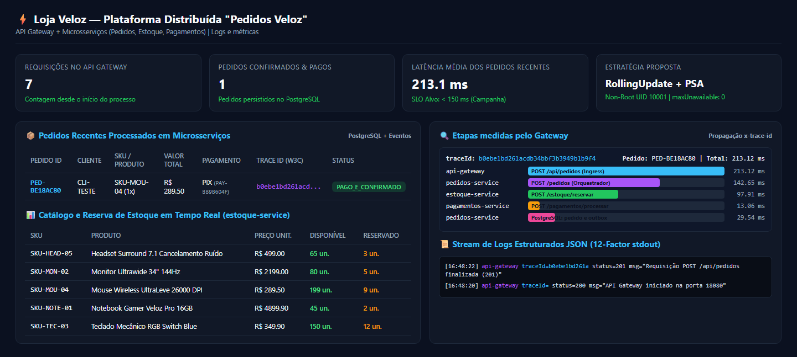
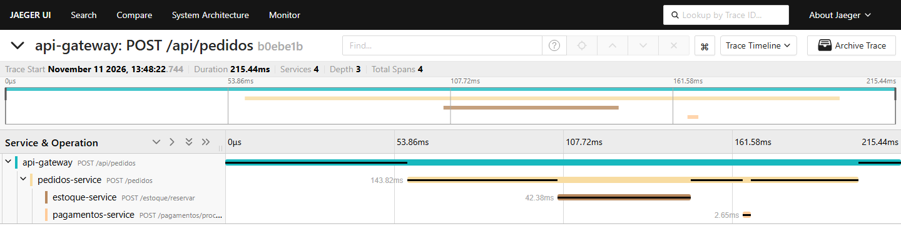

# Parte prática
## AMBIENTE DE DESENVOLVIMENTO
O README reúne os passos de execução. Na pasta services ficam o código, os testes e a receita de construção de cada serviço, chamada Dockerfile. O arquivo docker-compose.yml reúne os quatro serviços da aplicação, o PostgreSQL, o Redis e três ferramentas de acompanhamento: Jaeger, Prometheus e Grafana. As instruções abaixo partem da pasta em que se encontra o README, com o Docker em execução.
> docker compose up -d --build --wait
> docker compose ps
> node scripts/smoke.js
O primeiro comando constrói as imagens e inicia o ambiente. O segundo mostra a situação de cada container. O terceiro, executado com Node.js, envia uma compra e procura o mesmo pedido na listagem. O painel pode ser aberto em http://127.0.0.1:8080. Para encerrar, usa-se docker compose down. Os volumes preservam os dados para a próxima execução.
O Compose define as redes de entrada e de comunicação interna. Dentro delas, um serviço pode encontrar o outro pelo nome. O arquivo .env.example mostra as configurações de desenvolvimento. Cada imagem é construída em duas etapas. Na primeira, são executadas as verificações de código e os testes. Na segunda, entram apenas os arquivos necessários para executar a aplicação. O processo roda com o usuário 10001, sem permissão de administrador.
## RESULTADO NO DOCKER COMPOSE
Na execução registrada em 11 de novembro, os nove containers estavam em funcionamento. Seis deles informavam a condição “healthy”; os outros três apareciam como ativos. O teste criou o pedido PED-475B842A e recebeu a resposta HTTP 201, que indica a criação do registro. A quantidade disponível do mouse passou de 200 para 199. O banco registrou a publicação do evento e a mensagem apareceu no Redis. Esses resultados estão reunidos na pasta evidencias/compose.
---
## O PEDIDO DO CLIENTE NO WINDOWS
No teste executado diretamente no Windows, foi solicitada uma unidade do mouse SKU-MOU-04, no valor de R$ 289,50, com pagamento simulado por PIX. A resposta informou o número PED-BE18AC80. Em seguida, a consulta encontrou o mesmo pedido. A figura mostra o painel usado para acompanhar essa compra.

A compra também permitiu testar uma interrupção na mensageria. No primeiro momento, o evento EVT-BBA2F023 aparecia como pendente no banco. Quando o Memurai, compatível com o Redis no Windows, foi iniciado, o sistema enviou a mensagem. A leitura do stream encontrou o mesmo evento e o banco passou a marcar a publicação como concluída.
Em outro teste, a tentativa de comprar 11 notebooks ultrapassou o limite do simulador. A resposta foi HTTP 422. Ao conferir o banco, os 45 notebooks continuavam disponíveis e a quantidade reservada voltou ao valor inicial de dois. Essa conferência ajuda a identificar um erro que a mensagem de recusa, sozinha, não mostraria: manter reservado um produto de uma compra que não foi concluída.
---
## COMO ENCONTRAR UMA FALHA
O Gateway atribui um identificador à compra e o repassa aos serviços que participam dela. Cada serviço registra a sua etapa e envia os tempos de execução. No Jaeger, as barras mostram quando cada etapa começou e quanto tempo durou. Na figura, é possível abrir o caminho percorrido pelo pedido do painel anterior.

O Prometheus coleta métricas dos serviços e o Grafana permite consultá-las. Para acompanhar uma campanha, vale observar quantas compras falham, quanto tempo os clientes esperam e há quanto tempo o aviso mais antigo aguarda publicação no banco. Já os logs registram o serviço, o resultado e o identificador da chamada. Essa informação permite relacionar um erro específico ao pedido correspondente.
## PUBLICAÇÃO DAS IMAGENS
O arquivo ci-cd.yaml define o fluxo do GitHub Actions. Primeiro são verificados o código, os Dockerfiles e as configurações. Depois são executados os testes e uma compra no Compose. O arquivo de resultados que acompanha o projeto registra 13 testes aprovados. A etapa seguinte constrói as quatro imagens e usa o Trivy para procurar vulnerabilidades antes do envio ao registro de imagens do GitHub, o GHCR.
O fluxo identifica a imagem pela versão e pelo código da alteração no Git. As credenciais são fornecidas ao processo por meio de secrets. A publicação no GHCR está definida no projeto; o material entregue documenta as imagens carregadas no computador de teste. Para confirmar uma publicação externa, é preciso consultar a execução do GitHub Actions e a imagem correspondente no registro.
---
## ATUALIZAÇÃO E SEGURANÇA NO KUBERNETES
No laboratório de 12 de novembro, o Kubernetes do Docker Desktop executou nove cópias dos serviços, chamadas pods. Banco, Redis e Jaeger continuaram acessíveis pela rede do laboratório. A compra PED-90C870D6, enviada pelo endereço do Gateway no cluster, recebeu HTTP 201. As configurações usadas estão em k8s e os resultados estão em evidencias/kubernetes.
Os arquivos Deployment definem como manter as cópias da aplicação. Os Services oferecem um endereço estável para encontrá-las. O ConfigMap reúne portas e endereços. O Secret fornece credenciais. A verificação /ready indica se a cópia pode receber chamadas; /health permite identificar um processo que precisa ser reiniciado. Os serviços executam sem privilégios e com os arquivos principais apenas para leitura. A política de rede limita as conexões recebidas pelos serviços internos.
No primeiro teste de atualização com consultas em andamento, três das 6.046 requisições retornaram erro 502. Algumas chamadas ainda chegavam enquanto a versão antiga estava sendo encerrada. Na versão 1.2.1, o serviço passou a avisar que deixaria de receber tráfego e a aguardar cinco segundos antes de encerrar. O Gateway também passou a repetir uma leitura quando a conexão falha. No novo ensaio, as 25.979 consultas receberam resposta 200.
## ESCALA DURANTE O PICO
O HPA ajusta a quantidade de cópias conforme o uso de recursos. O Gateway pode variar de duas a dez cópias, com alvo de 70% da CPU solicitada. Pedidos varia de três a doze e considera também a memória. Estoque e Pagamentos têm duas cópias e uma configuração opcional que sugere ajustes de recursos.
No teste de quatro minutos, foram feitas 110.139 consultas à lista de pedidos. Todas receberam resposta 200. O Gateway passou de duas para dez cópias e Pedidos passou de três para dez. Esses números descrevem consultas em um computador de teste. Para planejar uma campanha, a equipe ainda precisa medir o comportamento com clientes criando pedidos e disputando os mesmos produtos.
---
## INFRAESTRUTURA E RESULTADOS
O Terraform descreve os recursos previstos para a AWS, como a rede, o cluster Kubernetes gerenciado e o banco PostgreSQL. Manter essa descrição no repositório permite revisar uma alteração antes de aplicá-la e usar o mesmo modelo com tamanhos diferentes no teste e na produção. O laboratório utilizou recursos locais. A proposta de infraestrutura na nuvem não gerou cobrança de implantação.
## QUADRO-RESUMO DO PROJETO
| Dificuldade | Medida adotada | Resultado observado |
| Interrupção na atualização | Aguardar o encerramento das chamadas em andamento. | A repetição do ensaio teve 25.979 respostas 200. |
| Aumento dos acessos | Ajustar as réplicas de Gateway e Pedidos pelo uso de recursos. | Ambos chegaram a dez réplicas no teste de consultas. |
| Dificuldade para localizar falhas | Acompanhar o mesmo pedido nos quatro serviços. | A consulta no Jaeger reuniu as etapas da compra. |
## CONCLUSÃO
O caso da Loja Veloz mostra a importância de testar uma compra do início ao fim. A confirmação do pagamento, a baixa do estoque e o envio do aviso são etapas diferentes e precisam ser conferidas. O teste de atualização mostrou ainda que um serviço pode iniciar corretamente e, mesmo assim, deixar uma chamada sem resposta ao encerrar. A correção desse problema e a identificação do pedido nos quatro serviços dão à equipe uma base para acompanhar a próxima campanha.
## REFERÊNCIAS
Google Cloud. Online Boutique. https://github.com/GoogleCloudPlatform/microservices-demo
Docker. Docker Compose. https://docs.docker.com/compose/
Kubernetes. Deployments e escala automática. https://kubernetes.io/docs/concepts/workloads/
OpenTelemetry. Sinais de observabilidade. https://opentelemetry.io/docs/concepts/signals/
GitHub. GitHub Actions. https://docs.github.com/actions
HashiCorp. Terraform. https://developer.hashicorp.com/terraform/docs
Vídeo da apresentação: {{VIDEO_URL}}
